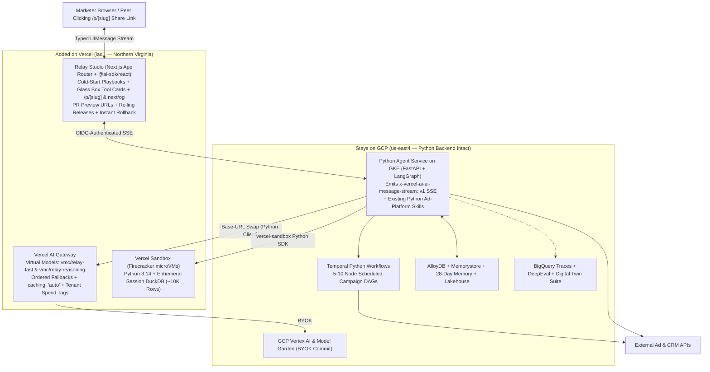
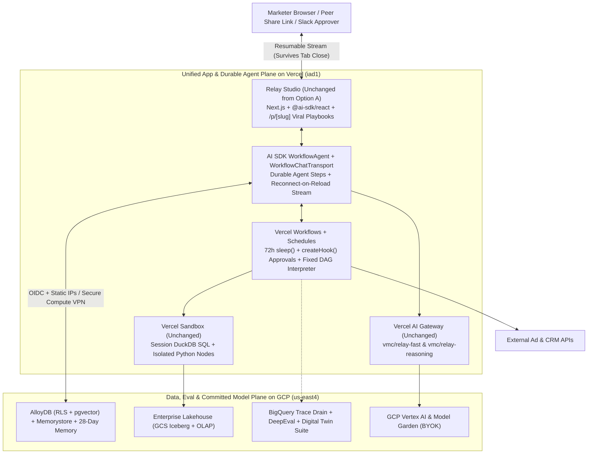

# Where Vercel Fits in an Agentic Marketing Platform — Architecture White Paper & Phase 2 (`Option B`) Roadmap

> **Purpose of This File:**
> 1. **Standalone Shareable White Paper (`.md`):** Answers the two-step architecture brief end-to-end for **Fieldstone's** campaign operations assistant (**Relay**), comparing **Option A (Augment Now — Keep Python Intact)** against **Option B (Replace Backend Runtime Later — Phase 2)**, including a sourced **Temporal vs. Vercel Workflows** evaluation and the **Python-to-TypeScript** timing justification.
> 2. **Vercel Interactive Executive Report Spec (Section 8):** Drop this `.md` file into Vercel (`v0.app` or a coding agent following `https://vercel.com/design.md`) to generate an interactive, Geist-styled executive briefing and presentation website.

---

## Executive Summary

**Fieldstone** is an established B2B marketing software provider building **Relay**, a greenfield agentic assistant that helps digital marketers audit ad creatives, analyze cross-channel performance, reallocate wasted ad budgets, and schedule deterministic monitoring workflows across Google Ads, LinkedIn Ads, Meta Ads, Analytics, and CRM.

Built in **Python** (`FastAPI`, `LangGraph`, `Temporal`, and `DeepEval`) on **Google Cloud (`us-east4`)**, Relay proved early internal value and opened self-serve Product-Led Growth (`PLG`) onboarding. As external marketers onboard, five compounding pain points threaten margin, reliability, and viral adoption:
1. **Model selection is left to end users, pinning ~90% of token spend *(illustrative scenario baseline)* to frontier reasoning models** even on simple read queries.
2. **In-process session analytics (~10,000 campaign rows in pod RAM)** couples Kubernetes memory growth directly to concurrent users.
3. **Blank-screen cold starts and plain-text chat responses** stall first-time self-serve marketers and miss Relay's peer-to-peer viral workflow-sharing loop.
4. **Frontend pull requests and releases contend on shared branches**, slowing a lean engineering team.
5. **Conversational turns block synchronously in the browser**, preventing multi-day autonomous campaign experiments when a user closes their tab.

**Architectural Recommendation — Two-Phase Strategy:**
- **Execute Now — Option A (Augment the Python Stack):** Add **4 Vercel primitives**—**Vercel AI Gateway**, **Vercel AI SDK UI (`@ai-sdk/react`) + Next.js (`next/og`)**, **Vercel Sandbox**, and **Preview Deployments & Rolling Releases**—while keeping 100% of Fieldstone's Python `LangGraph` agent service, Python `Temporal` workflows, `AlloyDB` state, `DeepEval` test suite, and committed `Vertex AI` spend on GCP `us-east4`. Option A solves Pains 1–4 in weeks with zero rewrite of Python business logic.
- **Defer to Phase 2 — Option B (Replace the Backend Agent & Workflow Runtime):** Defer migrating backend orchestration to **Vercel Workflows + AI SDK `WorkflowAgent`** until multi-day autonomous runs become mandatory and the **Python-to-TypeScript codebase barrier** (and beta status of Vercel's Python Workflow SDK) is retired behind hard readiness gates.

---

## Step 1: Start From What You Know — The Architecture & Its Pain

### 1.1 Current As-Built Stack (`us-east4`)
- **Presentation:** Single-page React chat UI + visual DAG viewer behind Envoy/Istio ingress.
- **Agent Runtime:** Single-tenant **Python `LangGraph`** service on self-managed Kubernetes (`GKE`) running four modes (`Explorer` for 5–10 turn live API analysis, `Planner`, `Workflow Builder`, and versioned `Skill` wrappers), holding ~10,000 fetched campaign rows in an **in-process `DuckDB`** instance per session.
- **Scheduled Workflows:** **Temporal** executing 5–10 node Python DAGs on a cron schedule.
- **Models & State:** Direct calls to **Vertex AI & Model Garden** (`Claude Sonnet` and `Gemini` families, 100% on-demand PayGo) with a raw model dropdown exposed in the UI; **AlloyDB** (`PostgreSQL + pgvector`), **Memorystore**, a strict **28-day raw message retention cap**, and offline **`DeepEval`** regression tests against stateful mock ad-platform APIs ("Digital Twins").

### 1.2 Where the Architecture Becomes Slow, Expensive, Risky, or Hard to Operate

| # | Technical Friction | Evidence in the Current Stack | Business Consequence (Money, Time, or Risk) | Addressed In |
| :-- | :--- | :--- | :--- | :---: |
| **1** | **Frontier-tier model lock-in & user model-picker drag** | UI exposes a model selector; smaller models struggled on unvalidated write schemas, leaving ~90% of production AI spend *(illustrative)* on frontier `Claude Sonnet` models despite a 70/30 fast-to-reasoning target and ~4% client 4xx error bursts. | Token COGS erodes unit margin on self-serve credit packs; frontier latency slows 5–10 turn sessions; 3P Marketplace models forfeit 1P cloud commit discounts. | **Option A** *(Now)* |
| **2** | **Session datasets held inside Kubernetes pod RAM** | `Explorer` loads ~10,000 rows of ad-platform results into in-process `DuckDB` inside shared agent pods. | Pod memory and OOMKill risk scale linearly with concurrent sessions; blocks clean horizontal pod autoscaling. | **Option A** *(Now)* |
| **3** | **Blank-screen cold start & zero viral artifact sharing** | First-time PLG signups face an empty chat input; insights render as text walls rather than interactive "Glass Box" cards or shareable peer playbooks. | High self-serve drop-off before "time to magic"; breaks the individual $\rightarrow$ peer $\rightarrow$ org viral PLG loop. | **Option A** *(Now)* |
| **4** | **Release contention & regression risk on a lean team** | Engineers report merge conflicts, staging bottlenecks, and fragile harness regressions with *"more work than people."* *(🟡 Release pipeline details inferred from team workshop notes.)* | Slower shipping velocity; UI and routing tweaks risk breaking active paying marketers. | **Option A** *(Now)* |
| **5** | **Synchronous browser-blocking agent turns & unverified write gates** | All conversational turns block on an open browser tab; zero background agents run today; live ad-budget write gating is unconfirmed. | Users abandon slow turns; blocks planned multi-day autonomous A/B campaign experiments; an ungated write error can burn customer ad spend. | **Option B** *(Phase 2)* |

*(Out of scope for Vercel and kept explicitly on the data/application roadmap: upstream 3P SaaS API rate limits on Marketo/Meta/LinkedIn, 28-day compliance memory distillation into `pgvector`, and database-level multi-tenant Row-Level Security.)*

---

## Step 2: Design Where Vercel Fits — Option A Now, Option B Later

### 2.1 Selected Vercel Primitives (No Catalog Dump)

| # | Vercel Primitive | AI Stack? | Phase Introduced | Specific Architectural Job |
| :-- | :--- | :---: | :---: | :--- |
| **1** | **Vercel AI Gateway** | **Yes** | **Option A (Now)** | Central model endpoint (`ai-gateway.vercel.sh`) providing Virtual Models (`vmc/relay-fast`, `vmc/relay-reasoning`), ordered model fallbacks, `caching: 'auto'`, and per-tenant/per-agent spend tags over **Vertex AI BYOK** (`0%` Vercel token markup). |
| **2** | **Vercel AI SDK (`@ai-sdk/react` UI now; `WorkflowAgent` in Phase 2)** | **Yes** | **Option A (UI) $\rightarrow$ Option B (Core)** | In Option A, streams typed `UIMessage` tool cards, inline confirmations, and `/p/[slug]` + `next/og` viral share playbooks on Next.js over SSE from Python. In Option B, upgrades backend orchestration to `WorkflowAgent` + `WorkflowChatTransport`. |
| **3** | **Vercel Sandbox** | — | **Option A (Now)** | Ephemeral Firecracker microVMs (`Python 3.14`, Active CPU billing at `$0.128/hr`, zero charge during LLM I/O wait) isolating 10,000-row `DuckDB` SQL queries and generated Python outside pod RAM and outside LLM token context. |
| **4** | **Preview Deployments & Rolling Releases** *(with Instant Rollback)* | — | **Option A (Now)** | Per-PR immutable preview URLs in `iad1` (same Washington, D.C. / Northern Virginia metro as GCP `us-east4`), canary Rolling Releases, and second-level Instant Rollback. |
| **5** | **Vercel Workflows** *(`'use workflow'`, `'use step'`, `createHook`, `Schedules`)* | **Yes** | **Option B (Phase 2)** | Serverless durable execution with deployment-pinned Skew Protection, `$0`-compute multi-day `createHook()` human approval waits, and scheduled runs via a fixed DAG interpreter. |

*(Supporting security plumbing: **Vercel OIDC Workload Identity Federation** + **Static IPs** authenticate Vercel `iad1` traffic to GCP `us-east4` without static cloud keys in app code.)*

---

### 2.2 Explicit Cloud Boundary: What Stays on GCP (`us-east4`) and Why

Drawing a disciplined boundary protects Fieldstone's cloud commitment, data gravity, and engineering velocity:

| System Remaining on GCP (`us-east4`) | Stays in Option A? | Stays in Option B? | Architectural & Commercial Reason |
| :--- | :---: | :---: | :--- |
| **Vertex AI & Model Garden Inference** | **Yes** | **Yes** | Reached via AI Gateway **BYOK** (`order: ['vertex']`) with zero Vercel markup so token spend continues retiring Fieldstone's committed GCP spend. |
| **AlloyDB (`pgvector` + Graph), Memorystore & 28-Day Memory Pipeline** | **Yes** | **Yes** | Customer state, Row-Level Security, and 28-day raw message purge pipelines belong next to transactional data in `us-east4`. |
| **Enterprise Lakehouse (`GCS Iceberg` + OLAP Serving)** | **Yes** | **Yes** | Zero-copy enterprise account/intent graph (`~200 TiB` scale) has massive data gravity in `us-east4`; moving it would incur cross-cloud egress with zero user benefit. |
| **`BigQuery` Traces, `DeepEval` & Digital Twin Mock Suite** | **Yes** | **Yes** | Fieldstone's offline write-verification harness is a core engineering asset that already works. |
| **Python `LangGraph` Agent Service (`GKE`) & `Temporal` Python DAGs** | **Yes** | *Migrates in Phase 2* | Preserved 100% intact in Option A to avoid a mid-launch Python-to-TypeScript rewrite; replaced only in Option B once Phase 2 gates pass. |

---

### 2.3 Option A Architecture (Execute Now — Zero Python Backend Rewrite)

**Why Option A Works in Weeks:**
- `@ai-sdk/react`'s `useChat` consumes the standard HTTP/SSE **UI Message Stream Protocol** (`x-vercel-ai-ui-message-stream: v1`), documented by Vercel for Python/FastAPI backends. Fieldstone upgrades the UX and viral sharing loop in Next.js without rewriting Python orchestration.
- Python `LangGraph` points its OpenAI-compatible client `base_url` at `ai-gateway.vercel.sh/v1` (~25-line change) and invokes `vercel-sandbox`'s first-party Python SDK (`vercel.sandbox`) to run 10,000-row `DuckDB` queries inside isolated microVMs.

---

## 3. Temporal vs. Vercel Workflows — Sourced Engineering Comparison

Should Fieldstone move its deterministic workflows from **Temporal** to **Vercel Workflows**? Checking both vendors' primary documentation (`docs.temporal.io` and `workflow-sdk.dev/docs/comparisons/workflow-sdk-vs-temporal`, updated Nov 16, 2026) shows they share the **exact same durability model**—an event log paired with deterministic replay (`'use workflow'` $\approx$ Temporal Workflow; `'use step'` $\approx$ Temporal Activity)—but diverge sharply in operations and language maturity:

| Dimension | Temporal (`docs.temporal.io`) | Vercel Workflows (`vercel.com/docs/workflows`) |
| :--- | :--- | :--- |
| **Where Worker Code Runs** | **Customer runs and autoscales Worker fleets** (`GKE` / VMs) polling Task Queues. Even Temporal Cloud hosts orchestration only (*"Temporal Cloud does not execute your application code"*). | **Serverless inside your deployment** (`Fluid Compute` + `Vercel Queues`). Zero worker fleets to run; suspended waits consume zero compute. |
| **Deploying With Runs in Flight** | Changing workflow code while runs are active causes **non-determinism replay errors** unless engineers add `patched()` / `GetVersion` branches or drain old Worker Versions. | **Deployment-pinned Skew Protection by default:** every run finishes on the immutable deployment that started it. |
| **Language SDK Maturity** | **7 GA SDKs:** Python, TypeScript, Go, Java, .NET, PHP, Ruby. | **TypeScript / JavaScript GA**; **Python SDK (`vercel-workflow`) is in Beta** (*"APIs and behavior may change before GA"*). |
| **Payload & History Limits** | **`2 MB` max payload** per request (`BlobSizeLimitError` above `2 MB` requires external S3/GCS claim-check plumbing); `51,200` events or `50 MB` history before `Continue-As-New`; `500` Actions/sec Cloud default floor. | **`50 MB` max payload**; `10,000` steps and `25,000` events per run (`2 GB` state/run); `1,000` run starts/sec; no run or `sleep()` duration limit; Enterprise retains run payloads `30 days` post-completion (up to `126 days`). |
| **Agent Loops & Browser Streaming** | `@temporalio/ai-sdk` and Workflow Streams are in **Public Preview** *(per Vercel's Nov 16 comparison)*; streaming rides on Signals/Updates recorded in history. | **`WorkflowAgent`** (`@ai-sdk/workflow`) + **`WorkflowChatTransport`** ship natively with token-level streams that reconnect across page reloads and function timeouts. |
| **Human Approval Waits** | Signals or Updates + `condition()` guards inside long-lived workflows. | `createHook()` / `needsApproval: true` on tools—suspends for hours or months at `$0` compute. |
| **Orchestration Unit Cost (10-Step Run)** | From **`$50` per 1M Actions** (`1` start + `10` activities = `11` Actions $\approx$ **`$0.00055`** — 🟡 *Medium Risk: excludes retries, storage, and GKE worker compute*). | **`$0.02` per 1K Events** (`10` steps $\times 3$ events + `~3` run events $\approx 33$ events $\approx$ **`$0.00066`** — 🟡 *Medium Risk: excludes `$0.50/GB` data written/retained and function Active CPU*). |

**Verdict on Switching:**
- **Do NOT move existing scheduled Python DAGs off Temporal today:** Fieldstone's 5–10 node scheduled workflows have no engine scaling bottleneck, orchestration fees are roughly identical (`$0.00055` vs. `$0.00066`), and their workflow code is Python while Vercel's Python Workflow SDK is still in beta.
- **DO use Vercel Workflows in Phase 2 for durable agent turns & multi-day approvals**—where eliminating worker fleets, avoiding `2 MB` context payload limits, pinning mid-flight runs across frequent deploys, and streaming resumable turns to the browser replace four stitched infrastructure layers.

---

## 4. Why Option B Is Wrong *Now* — and Why It Becomes Right *Later*

### 4.1 Four Reasons Option B Is Not the Right Move Today
1. **The Python-to-TypeScript Codebase Barrier (Decisive Factor):** 100% of Fieldstone's agent orchestration, ad-platform skills, `DeepEval` harnesses, and `Temporal` DAGs are Python. On Vercel, `WorkflowAgent` and GA `Workflows` are TypeScript-first, while `vercel-workflow` Python and `AI SDK for Python` are both in beta. Forcing Option B today means either rewriting stabilized Python logic into TypeScript mid-launch or running customer ad budgets on beta Python APIs.
2. **Framework Churn Fatigue:** Having already iterated across multiple agent frameworks this year to stabilize tool accuracy, freezing connector delivery for a multi-month backend port (🔴 *High Risk effort estimate: 1+ quarter without internal velocity telemetry*) hurts commercial momentum on a team that already has *"more work than people."*
3. **Scheduled Workflows Already Work:** Moving working 5–10 node Python cron DAGs delivers near-zero cost or scale delta today.
4. **Option A Captures Immediate Value Without Rewrite Risk:** AI Gateway, Next.js + `@ai-sdk/react` viral UX, Sandbox Python offload, and Preview/Rolling Releases ship in weeks with zero throwaway UI work.

### 4.2 Three Readiness Triggers That Make Option B the Right Move in 6–9 Months
1. **Product Roadmap Moves to Multi-Day Autonomous Campaigns:** Once Fieldstone ships **72-hour autonomous A/B creative/bid experiments** and **asynchronous Slack/inbox budget approvals**, synchronous HTTP SSE requests can no longer hold state. Building durable step checkpointing + reconnectable browser streaming + `$0`-compute multi-day waits on `Python + LangGraph + Temporal + Redis` is far heavier than adopting `WorkflowAgent` + `Workflows` behind the **exact Next.js UI already deployed in Option A**.
2. **Python Barrier Retires via One of Two Clean Paths:**
   - *Path B1 (Native Python GA):* `vercel-workflow` Python exits beta into GA with full stream and hook parity—removing the language switch completely.
   - *Path B2 (MCP Boundary):* As Fieldstone expands from 7 to 50+ integrations, wrapping Python connectors behind typed **Model Context Protocol (`MCP`)** servers shrinks the TypeScript port to a thin outer `WorkflowAgent` state machine while Python domain skills stay in Python (`Sandbox` or MCP endpoints).
3. **Consolidating Worker Ops at Scale:** Once thousands of concurrent self-serve + enterprise runs make scaling stateful `GKE` pods and draining `Temporal` worker versions an operational burden, consolidating onto serverless `Fluid Compute` + deployment-pinned `Workflows` pays back the migration.

### 4.3 Option B Target Architecture (Phase 2 — Zero Frontend Rewrite Over Option A)

---

## 5. Side-by-Side Comparison: Option A vs. Option B

| Dimension | Option A: Augment Now *(Phase 1 — Recommended)* | Option B: Replace App & Agent Runtime *(Phase 2 — Gated)* |
| :--- | :--- | :--- |
| **Vercel Primitives** | `AI Gateway`, `AI SDK UI` (`@ai-sdk/react` + `next/og`), `Sandbox`, `Preview Deployments & Rolling Releases` | Adds `Vercel Workflows` + `AI SDK WorkflowAgent` + `Vercel Schedules` |
| **Backend Code Change** | ~45-line Python SSE adapter + AI Gateway base URL + `vercel-sandbox` Python tool | Port outer agent loop to TypeScript `WorkflowAgent` (or wait for Python Workflow SDK GA) + wrap Python tools as MCP |
| **Estimated Delivery Effort** *(🔴 High Risk)* | **3–4 Weeks** | **10–14 Weeks** *(via 4-wave Strangler-Fig rollout)* |
| **Reversibility** | **High** (env-var base URL & DNS switch) | **Moderate-to-Low** (orchestration state lives in Workflows) |
| **Cloud Commit Impact** | **100% Preserved** via Vertex AI BYOK | **100% Preserved** via Vertex AI BYOK |
| **Solves** | Frontier token cost, pod RAM bloat, cold-start UX, viral `/p/[slug]` sharing, PR preview/canary safety | Everything in Option A **plus** tab-close survival, multi-day `$0`-compute approvals, and zero worker fleets |

---

## 6. Trade-Offs, Limits & Security Invariants

1. **AI Gateway Budgets Do Not Cap BYOK Spend:** Vercel's documentation specifies that AI Gateway budgets meter Vercel-billed credits and exclude BYOK provider spend (`vercel.com/docs/ai-gateway/observability-and-spend/budgets`). Per-tenant daily caps stay enforced in Relay's application credit ledger, fed by AI Gateway Custom Reporting (`$0.075` per 1,000 tag/user writes).
2. **BYOK Fallback to Vercel Keys (`$0.20 / 1K` Toggle):** By default, failed BYOK calls retry using Vercel's provider keys (shifting that fallback call off the GCP commit). Turning *Fallback to Vercel Keys* off keeps 100% of calls on Vertex AI at `$0.20` per 1,000 BYOK requests (`vercel.com/docs/ai-gateway/authentication-and-byok/byok`).
3. **Never Run Model-Generated DAGs as `experimental_dynamic` Workflows:** Workflow SDK docs explicitly warn that `experimental_dynamic` JavaScript runs with full deployment privileges and environment variables (`workflow-sdk.dev/v5/docs/advanced/dynamic-workflows`). Customer DAGs must execute via a **fixed, deployed interpreter workflow** passing generated Python strictly into **Vercel Sandbox** (`networkPolicy: 'deny-all'`, `persistent: false`).
4. **Vertex BYOK Credentials:** Vertex BYOK uses service-account credentials (`project`, `location`, `googleCredentials`). Organizations blocking GCP service-account key creation require a scoped org-policy exception.
5. **Unverified Item Flagged for PoC:** Confirm during Week 1 testing whether pre-purchased cloud Provisioned Throughput units apply identically when invoked through AI Gateway BYOK regional endpoints (`inferenceRegion`).

---

## 7. Measurable Technical & Business Outcomes

*Scenario baselines below are coarse illustrative figures; targets are validated during a 2-week Phase 1 PoC.*

| Metric | Illustrative Baseline Today | Phase 1 Target (Option A — 30–90d) | Phase 2 Target (Option B — Post-Gate) | How Measured |
| :--- | :--- | :--- | :--- | :--- |
| **Frontier-tier share of model spend** | ~90% on one frontier family | **$\le 50\%$** (70/30 fast/reasoning call mix) | **$\le 40\%$** | AI Gateway spend by model & `tier:*` tag |
| **Time to update model routing / fallbacks** | Backend code change + deploy | **< 2 minutes** (`vmc/*` update, 0 deploys) | **< 2 minutes** | AI Gateway Virtual Model audit log |
| **Per-tenant & per-agent token cost visibility** | Unanalyzed raw logs | **Real-time / Daily** | **Real-time / Daily** | AI Gateway Custom Reporting (`user`, `tags`) |
| **Agent pod RAM growth under 10K-row queries** | Scales linearly per active session | **Stateless / Flat** (isolated in Sandbox) | **Serverless scale-to-zero** | Container RSS & Sandbox observability |
| **First-time user time-to-first-insight** | Blank chat prompt (high drop-off) | **< 15 seconds** via 1-Click Playbooks | **< 15 seconds** | Funnel telemetry & `/p/[slug]` remix rate |
| **PR to isolated reviewable preview URL** | Shared branch contention | **< 3 minutes**; < 5s Instant Rollback | **< 3 minutes** full-stack | Vercel Deployments log |
| **Runs surviving closed browser tabs / deploys** | `0%` (request-scoped) | `0%` *(deferred by design)* | **`100%`** (`WorkflowChatTransport` + Skew Protection) | Disconnect & mid-run deploy test |
| **Worker fleets to autoscale & drain** | `GKE` agent pods + `Temporal` workers | Unchanged *(0 Python rewrite)* | **`0` worker fleets** | Infrastructure inventory |

---

## 8. Vercel Interactive Executive Briefing & Presentation Build Spec (Optional Web Render)

If you drop this `.md` file into Vercel (`v0.app` or a coding agent) to render **Artifact 2 / Artifact 3** as a shareable web experience alongside the raw Markdown paper, build a single Next.js App Router project following **`https://vercel.com/design.md`** (`https://vercel.com/geist/vercel-brand.css`, `Geist` + `Geist Mono` fonts, default Node.js runtime, zero third-party chart libraries):

1. **Dual-Mode Top Toggle (`Executive White Paper` $\leftrightarrow$ `10-Slide Presentation Mode`):**
   - *White Paper Mode:* Calm, editorial long-form technical report with sticky left section index, single-drawn `1px` Geist borders, and tabular-numeral evidence tables.
   - *Presentation Mode:* Keyboard-navigable (`←` / `→`) 10-slide widescreen executive deck summarizing: (1) Scenario & Mandate, (2) 5 Ranked Pain Points, (3) Why Option A Now, (4) Option A Architecture & GCP Boundary, (5) Viral PLG & Glass Box UX, (6) Temporal vs. Workflows Reality Check, (7) Why Option B Waits (Python-to-TypeScript Barrier) & When It Unlocks, (8) Option B Phase 2 Architecture, (9) Interactive Unit-Economics & Workflow Cost Calculator, and (10) 90-Day PoC & Measurable Outcomes.
2. **Three Interactive Architecture Proof Widgets Embedded Inline:**
   - **Phase Switcher Diagram (`Current Stack` $\rightarrow$ `Option A: Augment Now` $\rightarrow$ `Option B: Phase 2`):** Highlights in green what changes on Vercel, locks in slate what remains on GCP `us-east4`, and displays code-change impact (`0 lines` vs. `Python-to-TS / MCP`).
   - **Interactive Token Margin Simulator:** Sliders for monthly active marketers, turns per session, and **Fast-Tier Routing %** (`10%` baseline $\rightarrow$ `70%` target) computing live monthly AI cost using verified AI Gateway rates (`google/gemini-4-hydrogen` `$1.50/$7.50` per 1M vs. `google/gemini-4-argon` `$2.00/$10.00` per 1M).
   - **Phase 2 Go/No-Go Readiness Checklist:** Interactive 3-gate evaluator showing why Option B stays locked today and turns green once Option A ROI, multi-day A/B requirements, and Python SDK GA / MCP boundaries are checked.

---

## 9. Primary Sources Verified (Nov 16–17, 2026)

- [Vercel AI Gateway Documentation](https://vercel.com/docs/ai-gateway) & [Live Model Catalog API](https://ai-gateway.vercel.sh/v1/models) (BYOK, Virtual Models, Routing Rules, Caching, Budgets & Pricing — verified Nov 16–17, 2026).
- [AI SDK UI Stream Protocol](https://ai-sdk.dev/docs/ai-sdk-ui/stream-protocol), [Chatbot Tool Usage](https://ai-sdk.dev/docs/ai-sdk-ui/chatbot-tool-usage) & [Python with AI SDK Guide](https://vercel.com/kb/guide/python-and-ai-sdk).
- [Vercel Workflows Documentation](https://vercel.com/docs/workflows) & [Workflow SDK vs. Temporal Comparison](https://workflow-sdk.dev/docs/comparisons/workflow-sdk-vs-temporal) (updated Nov 16, 2026).
- [Temporal Cloud Overview](https://docs.temporal.io/cloud/overview), [Pricing](https://docs.temporal.io/cloud/pricing), [Limits](https://docs.temporal.io/cloud/limits) & [Workflow Determinism](https://docs.temporal.io/workflow-definition).
- [Vercel Sandbox](https://vercel.com/docs/sandbox), [OIDC GCP Federation](https://vercel.com/docs/oidc/gcp), [Regions](https://vercel.com/docs/regions), [Geist Design System](https://vercel.com/geist/introduction) & [Vercel Report Design Guidelines](https://vercel.com/design.md).
